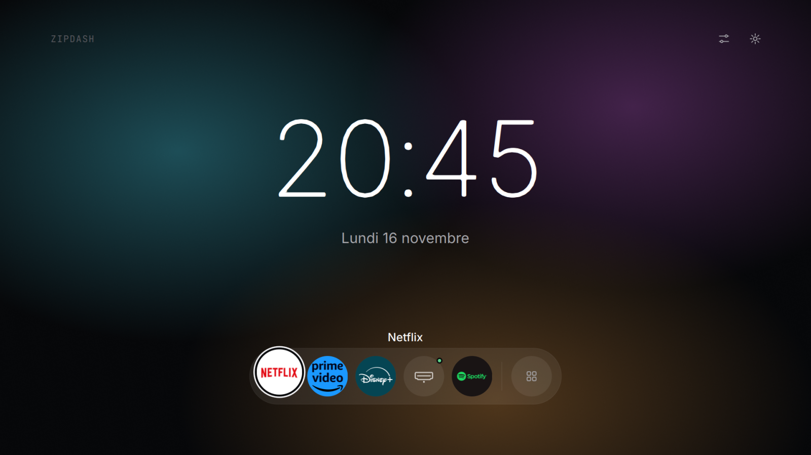
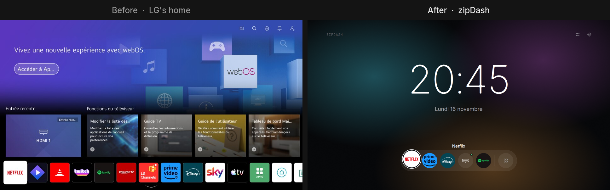
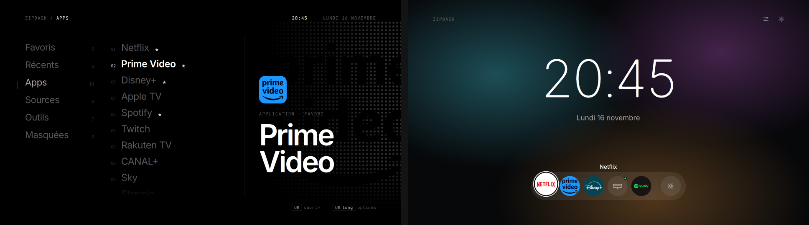
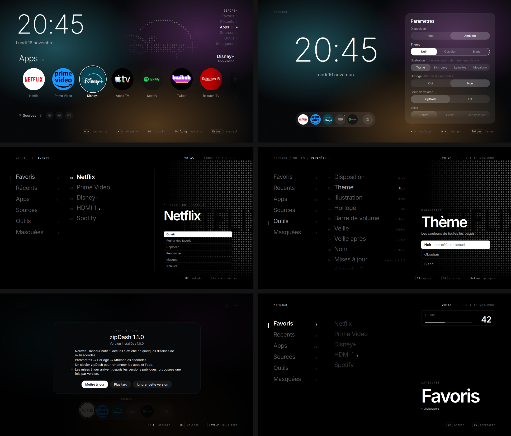

<p align="center">
  
</p>

<p align="center">
  <a href="https://github.com/ZIPender/zipDash/releases/latest"><b>Latest release</b></a> ·
  <a href="#install">Install</a> ·
  <a href="#see-it-move">See it move</a> ·
  <a href="#what-you-get">What you get</a> ·
  <a href="#going-back-to-lg">Going back to LG</a> ·
  <a href="https://github.com/ZIPender/zipDash/issues">Report a bug</a>
</p>

zipDash replaces the LG home screen with a quiet one: your apps, inputs and
favourites, a clock, and nothing else. No ads, no "recommended for you", no
sponsored tiles. It is a native app (Qt Quick, the same technology LG uses for
its own system screens), so it opens in 20 to 35 milliseconds and uses almost no
processor time while it sits there.

<p align="center">
  
</p>

<p align="center"><sub>Left: LG's home on the test TV, with its sponsored tiles and recommendation rows already turned off. Right: zipDash, from its PC preview with sample apps.</sub></p>

While zipDash is installed, LG's home screen, screensaver, power-off logo and
pop-up messages are replaced. Remove it and everything is LG's again, as it was.

## See it move

https://github.com/user-attachments/assets/25461e2a-b24e-48c7-ad04-00489e6c290b

<p align="center"><sub><b>Index</b> in <b>Blanc</b>, with an Xbox controller · <a href="media/demo-index-white.mp4">MP4</a></sub></p>

https://github.com/user-attachments/assets/23b3611a-4323-49cc-b636-cbf1713d93d0

<p align="center"><sub><b>Ambient</b> in <b>Obsidian</b>, with a PlayStation controller · <a href="media/demo-ambient-obsidian.mp4">MP4</a></sub></p>

<p align="center"><sub>Recorded from zipDash's PC preview with sample apps and an invented song; on the TV it looks the same.</sub></p>

## Install

**You need:** an LG TV with webOS 6 (2021 models), rooted, with
[Homebrew Channel](https://github.com/webosbrew/webos-homebrew-channel)
installed. zipDash is tested on an OLED A1; other webOS 6 TVs should work.

1. In **Homebrew Channel**, open **Settings** › **Add repository** and enter:
   ```
   https://raw.githubusercontent.com/ZIPender/zipDash/main/repo/apps.json
   ```
2. Back in the list, pick **zipDash Setup** and press **Install**.
3. Open **zipDash Setup** from your apps and press **Installer zipDash**. A few seconds
   later, zipDash opens. Press **Home** on the remote: it is your home
   screen now.

<details>
<summary><b>Other ways to install</b></summary>

- Download `zipdash-setup_<version>.ipk` from the
  [latest release](https://github.com/ZIPender/zipDash/releases/latest) and
  install it with [webOS Dev Manager](https://github.com/webosbrew/dev-manager-desktop)
  or `ares-install`, then follow step 3.
- Over SSH as root: copy the IPK to the TV, install it with
  `luna-send -i luna://com.webos.appInstallService/dev/install '{"id":"org.lgdebloat.setup","ipkUrl":"/tmp/zipdash-setup.ipk","subscribe":true}'`,
  then run `node /media/developer/apps/usr/palm/applications/org.lgdebloat.setup/setup.js install`.
</details>

## What you get

<p align="center">
  
</p>

- **Two layouts, the same features.** *Index* is a calm list: categories on the
  left, your apps in the middle, a big title on the right. *Ambient* is a dock
  of round icons under a large clock; press **Down** for every app. Switch any
  time in **Paramètres**.
- **Three themes:** Noir, Obsidian (deep purple) and Blanc (white, black type, a red accent), with a choice of
  four illustration styles for app pictures.

- **Favourites, recent apps and hidden apps.** Hold **OK** on any app or input
  to add it to your favourites, move it, rename it or hide it.
- **Inputs that show what is plugged in.** HDMI ports with something connected
  are marked live.
- **Its own screensaver**, across the whole TV: a slow clock in your theme
  (Dérive, Orbite, or Constellation with your favourite apps). When a console
  goes to sleep on its input, zipDash's screensaver comes up instead of LG's
  "no signal" slideshow, and the TV still switches itself off after 15 minutes
  if you set it to.
- **The TV's pop-ups in your theme.** Messages such as "PS5 désormais disponible"
  take zipDash's look and theme, across the whole TV, in the style of your layout.
- **Its own volume bar and keyboard** (AZERTY or Swiss QWERTZ), drawn in your theme.
- **Your game controller as the remote.** A PS5, PS4 or Xbox controller drives zipDash,
  LG's menus and every app; games that use the controller keep it to themselves. zipDash's
  key hints then show its buttons (✕ ○ △, or A B Y).
- **What Spotify plays, on the screensaver.** When the screensaver comes up while Spotify
  plays on the TV: the cover, the song, its progress and synced lyrics (from
  [LRCLIB](https://lrclib.net), a free lyrics database), or the clock when a song has none.
  **Paramètres** › **Musique**: with lyrics, cover only, or the usual screensaver. It needs one
  setting on the TV, below.
- **Your name for it.** Rename zipDash to anything you like; the start-up screen
  and the power-off logo follow.
- **Updates from the TV.** zipDash checks this page for a new version when it
  starts and asks once: *Mettre à jour*, *Plus tard* or *Ignorer cette version*.
  **Paramètres** › **Mises à jour** checks on demand. After an update, it shows
  once what's new.
- **LG's home stays one press away.** Hold **Home** for a second to open LG's
  home screen, or use **Paramètres** › **Accueil LG**.

The interface is in French for now.

<p align="center">
  
</p>

<details>
<summary>Turning on the Spotify screensaver</summary>

zipDash reads Spotify through the TV's web inspector (port 9998), which lists store apps such
as Spotify only once the file `/var/luna/preferences/debug_system_apps` exists. That would also
let anything on your network open those apps through port 9998, so close the port to the network
at the same time; zipDash reads it from inside the TV. Over SSH as root:

```sh
touch /var/luna/preferences/debug_system_apps
H=/var/lib/webosbrew/init.d/50-lg-debloat-debugport
printf '#!/bin/sh\niptables -C INPUT -p tcp --dport 9998 ! -i lo -j DROP 2>/dev/null || iptables -I INPUT -p tcp --dport 9998 ! -i lo -j DROP\n' > $H
chmod 755 $H && $H
reboot
```

The last file puts the rule back at every start. To undo both:
`rm /var/luna/preferences/debug_system_apps /var/lib/webosbrew/init.d/50-lg-debloat-debugport`,
then restart the TV. Without the file, the screensaver stays the usual one.
</details>

## How fast

Measured on the OLED A1, on the home screen, back from another app:

| | LG's home | zipDash |
| --- | --- | --- |
| On screen after pressing Home | 66–85 ms | **20–35 ms** |
| Processor while idle | 22.5 % of a core | **0–0.1 %** |
| Memory | 83 MB | **27 MB** (Index) to **41 MB** (Ambient) |

## Going back to LG

In zipDash, **Paramètres** › **Revenir à LG**, or open **zipDash Setup** and
press **Revenir à l'accueil LG**. LG's home screen, screensaver, power-off
logo and pop-ups come back at once, and zipDash is removed with its settings. Nothing of LG's was ever
changed on the TV: zipDash lays its screens over LG's while it is installed.
zipDash Setup stays, so you can reinstall in one press; remove it from LG's app
list if you don't want it.

<details>
<summary><b>Troubleshooting</b></summary>

- **zipDash Setup says the TV is not rooted:** Homebrew Channel must show
  *Root status: ok* in its settings. zipDash needs root to replace the home
  screen.
- **Home opens LG's home after a TV update:** firmware updates can remove root.
  Root the TV again, then open zipDash Setup and press **Réparer zipDash**.
- **Something looks wrong:** open zipDash Setup and press **Réparer zipDash**. It
  reinstalls zipDash and keeps your settings.

Report bugs on the [issues page](https://github.com/ZIPender/zipDash/issues)
with your TV model, its webOS version and what you saw.
</details>

## Disclaimer

Unofficial project, not affiliated with or endorsed by LG Electronics. webOS
and LG are trademarks of LG Electronics. App names and icons on the pictures
belong to their owners. Use at your own risk: rooting a TV and replacing its
home screen is not supported by LG.

zipDash ships the Inter and JetBrains Mono fonts under the SIL Open Font
License: see [THIRD_PARTY_NOTICES.md](THIRD_PARTY_NOTICES.md).
